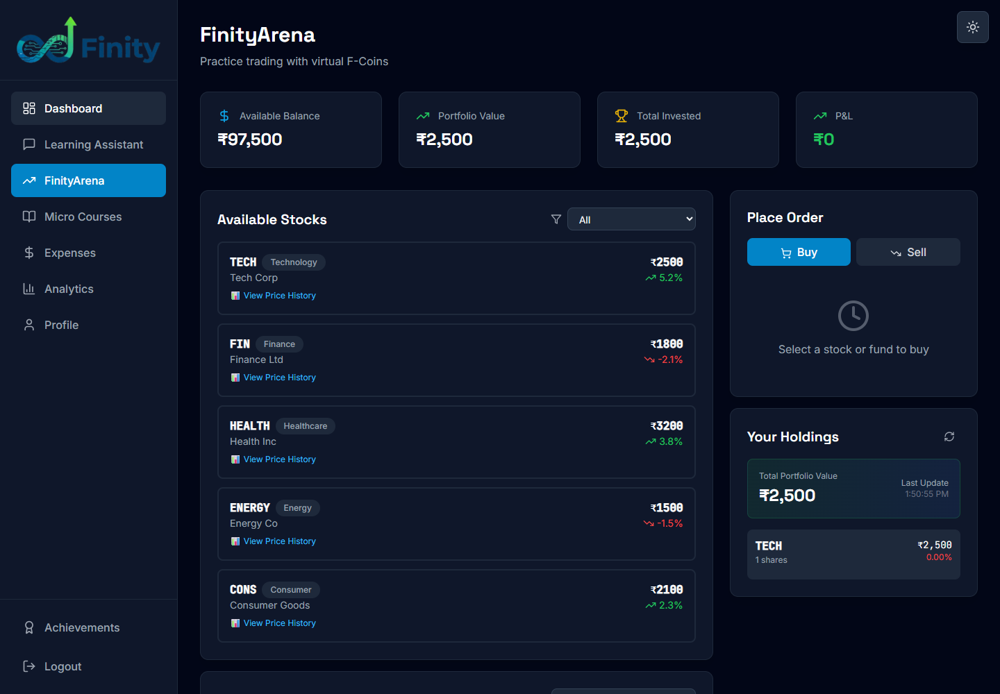
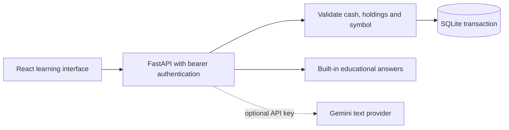

<div align="center">

# Finity

### Learn the money habits before putting money on the line.

A financial literacy playground combining a paper market, everyday expense records, short lessons and a learning assistant. Built as a collaborative 2025 hackathon prototype.

[](https://github.com/Muneer320/finity/actions/workflows/verify.yml)
[](LICENSE)

[Start the demo](#start-the-demo) · [Explore the learning loop](#a-small-learning-loop) · [Developer setup](#developer-notes)

</div>

**The market is fictional.** Prices, percentage changes and projection assumptions are teaching examples. No real orders are placed, no live price feed is connected, and projections are not forecasts or financial advice.



*A fresh demo account starts with ₹100,000 of paper cash. Buying one TECH unit for ₹2,500 leaves ₹97,500 and a saved holding. The screenshot shows that actual backend transaction.*

## A small learning loop

| Try something | See what changes |
| --- | --- |
| **Practice a trade** | Choose among eight fixed-price fictional assets. The server updates cash and holdings together and rejects overspending or overselling. |
| **Record everyday money** | Save expenses and income, then view analytics based on the recorded history. |
| **Explore a projection** | Change inputs to see a hypothetical investment scenario. Assumptions are illustrative. |
| **Ask and learn** | Use built-in educational explanations and short lessons, with optional provider-generated text. |

The aim is a place to connect a decision with its consequences while learning the vocabulary. Account data is scoped to the signed-in user; trading and transaction records live in SQLite rather than just the page's memory.

## Start the demo

With Docker installed, from the repository root:

```bash
docker compose up --build
```

Open **http://localhost:3000**, create a disposable account and complete the questionnaire. Visit **FinityArena**, buy one TECH unit, then refresh: the holding and reduced paper balance remain saved. The API explorer is at **http://localhost:8000/docs**.

No AI key is needed for paper trading, expenses, projections or built-in educational answers. Compose binds the app and API to loopback. `docker compose down` stops them while retaining the `finity_data` database volume.

For a long-lived local instance, set a strong `SECRET_KEY` in a root `.env` before starting. Never reuse a demo password for a real service.

## From the interface to a saved transaction



Balances and trades are server records. Some gamification counters and badges still use browser state, so they are illustrative rather than an authoritative progress record. The assistant receives conversation history in each request; conversations are not stored between sessions.

## Developer notes

<details>
<summary><strong>Native setup and configuration</strong></summary>

Use Python 3.13 and Node.js 22.12+ or 24. In a Python virtual environment, from the repository root:

```bash
python -m pip install -r backend/requirements.txt
cd backend
uvicorn main:app --reload --port 8000
```

In a second terminal, from the repository root:

```bash
cd frontend
npm ci
npm run dev
```

The frontend uses port 3000 and proxies API calls to `http://127.0.0.1:8000` by default.

| Setting | Purpose |
| --- | --- |
| Backend `DATABASE_URL` | SQLite by default; selects the database connection. Compose stores its file in the named volume. |
| Backend `SECRET_KEY` | Signs login tokens. Keep private and stable for persistent sessions. |
| Backend `ALLOWED_ORIGINS` | Comma-separated allowed frontend origins. |
| Backend `GEMINI_API_KEY` | Optional open-ended assistant/course text; omitted for the local fallback demo. |
| Frontend `VITE_PROXY_TARGET` | Development proxy target. |
| Frontend `VITE_API_BASE_URL` | Public API base URL when deploying the frontend separately. |

See [backend/.env.example](backend/.env.example). Native backend settings belong in `backend/.env`; Compose uses the root `.env` for its interpolated settings. Keep provider keys on the backend.

</details>

<details>
<summary><strong>Checks and current educational content</strong></summary>

In the configured Python environment, from the repository root:

```bash
python -m pip install httpx==0.28.1
cd backend
python -m unittest discover -s tests -v
```

From the repository root in another terminal:

```bash
cd frontend
npm run build
```

The backend integration test covers signup, separate users' balances, trading limits, expense records, streaks, profile edits, achievements and assistant fallback. CI runs that test and builds the frontend.

Three backend lessons cover budgeting and compounding; six additional frontend lesson cards are static educational content. The projection is a deterministic hypothetical calculation. Generated Gemini answers have not been independently validated as financial guidance.

</details>

## Scope and credits

This is a local, single-process learning prototype. The old hosted deployments were unavailable when the demo was repaired; no working public site is advertised. Use synthetic financial records when demonstrating it. A hosted database URL alone does not make this a production financial application.

**Amogh worked on the backend; Muneer worked on the frontend.** Their original hackathon collaboration is preserved here. To report a problem or propose an educational improvement, use [Issues](https://github.com/Muneer320/finity/issues) with a reproducible example and no private financial data. Changes to trading rules should retain account-isolation and balance tests. [MIT license](LICENSE).
